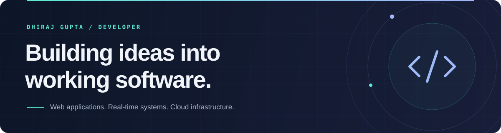

# Dhiraj Gupta

**Full-Stack Developer · Real-Time Applications · Cloud &amp; Backend Systems**

I build web applications with thoughtful interfaces, reliable APIs, and real-time data.

  
  
  

[About](#about) · [Selected projects](#selected-projects) · [Tech stack](#tech-stack) · [Learning](#currently-exploring) · [Activity](#github-activity)

## About

- Full-Stack Developer Intern at **Zversal Pvt Ltd**.
- B.Tech in Computer Science, **Kurukshetra University** · 2022–2026.
- Based in **Punjab, India**, with interests in system design, data engineering, and cloud deployment.
- I enjoy connecting the pieces: responsive interfaces, backend services, databases, and deployment.

## Selected projects

### Stock Simulator

**A paper trading platform for Indian markets.** Practise NSE equities and NFO futures and options with virtual money, streaming market data, interactive charts, and portfolio analytics.

- Delivery, intraday, and derivatives trading with order validation and a virtual wallet.
- WebSocket market updates, Python data workers, and a Go backend backed by PostgreSQL and Redis.
- Market news and an educational AI trade copilot.

`Next.js` `TypeScript` `Go / Gin` `Python` `PostgreSQL` `Redis` `WebSockets`

**[Live website](https://www.stock-simulator.in/)** · [Source code](https://github.com/Dhiraj10002/Stock-Simulator)

### Mannat Foundation

**A web platform for an NGO**, combining a responsive public website with an admin interface for content management.

- React interface styled with Tailwind CSS.
- Express API with MongoDB, JWT authentication, and Cloudinary media integration.

`React` `Vite` `Tailwind CSS` `Node.js` `Express` `MongoDB`

**[Live website](https://mannat-frontend.vercel.app/)** · [Frontend source](https://github.com/Dhiraj10002/mannat-frontend) · [Backend source](https://github.com/Dhiraj10002/mannat-backend)

## Tech stack

**Languages**

**Frontend**

**Backend &amp; data**

**Cloud &amp; delivery**

More tools and technologies

- **Languages &amp; web:** C, C++, HTML, CSS
- **Application development:** Redux, REST APIs, WebSockets, JWT
- **Databases &amp; data tools:** MySQL, Supabase, Apache Spark, DuckDB
- **Infrastructure:** Jenkins, Nginx, Cloudflare
- **Everyday tools:** Git, Postman, VS Code, Figma

## Currently exploring

- **System design:** API boundaries, caching strategies, and real-time data flows.
- **Cloud &amp; DevOps:** Containerized deployments, CI/CD pipelines, and observability.
- **Data engineering:** Data pipelines, query engines, and storage formats.
- **Problem solving:** DSA patterns and algorithmic thinking through LeetCode practice.

## GitHub activity

Contribution graph and coding streak

 

  

[View contributions on GitHub](https://github.com/Dhiraj10002?tab=overview)

---

**Have an interesting problem to build around? Let's connect.**

[LinkedIn](https://www.linkedin.com/in/dhirajgupta1002/) · [Portfolio](https://dhiraj-my-portfolio.vercel.app/)

